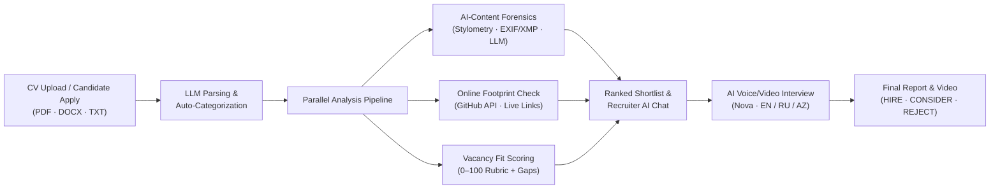

<p align="center">
  
</p>

<h3 align="center">Smart AI-HR Recruiter Assistant</h3>

<p align="center">
  End-to-end AI recruiting platform: automated CV screening, AI-content forensics, online footprint verification, strict fit scoring, recruiter chat-with-actions, and AI voice/video interviews powered by <strong>Nova</strong>.
</p>

<p align="center">
  
  
  
  
  
</p>

---

## Overview

**Ishveren** streamlines the hiring funnel from raw resumes to final hiring recommendations. Recruiters upload CVs (or candidates apply directly through the portal), run parallel AI screening against open vacancies, invite top candidates to structured voice/video interviews with **Nova** (an animated AI interviewer), and review scored reports with full video playback.



---

## Key Features

### 1. CV Parsing & Auto-Categorization
- Supports **PDF**, **DOCX**, and **TXT** resumes via bulk recruiter upload or candidate self-application.
- Automatically extracts candidate name, email, skills, years of experience, and portfolio/social links.
- Classifies resumes into 7 verticals: `Programmer`, `Sales`, `Manager`, `Designer`, `Marketing`, `HR`, and `Other`.

### 2. Multi-Signal AI-Content Detection (`0–100`)
Detects AI-generated resumes using a weighted three-layer pipeline:
- **Stylometric heuristics** — sentence-length burstiness (coefficient of variation), type-token vocabulary diversity, and AI buzzword density.
- **PDF image metadata scan** — inspects embedded image EXIF/XMP tags for camera signatures vs. AI generators (`Midjourney`, `DALL-E`, `Stable Diffusion`, `Firefly`, `Flux`, `C2PA`, etc.).
- **LLM forensic judge** — evaluates specificity, concrete metrics, and template phrasing, producing a verdict (`Likely human-written`, `Suspicious — mixed signals`, or `Likely AI-generated`) with itemized evidence.

### 3. Online Footprint Verification
- Fetches candidate **GitHub** profiles in parallel (public repositories, stars, primary languages, top non-fork repos, recent push dates).
- Verifies reachability and page titles of portfolio/project URLs listed on the CV.
- Cross-checks online evidence against resume claims for consistency.

### 4. Rubric-Based Vacancy Fit Scoring & Smart Caching
- Evaluates each candidate strictly against vacancy requirements (`0–100`), returning concrete **strengths**, **weaknesses**, **missing skills**, and a concise recruiter summary.
- Runs concurrently across a configurable thread pool (`ANALYSIS_WORKERS`, default `8`) with live progress polling and automatic `429` rate-limit backoff.
- **Vacancy-hash caching** skips already-scored CVs unless the vacancy text changes (with an option for a forced full re-scan).

### 5. AI Voice & Video Interviews — Nova
- **Structured 6-question flow**: warm-up, 3 progressive role-specific questions, 1 CV-claim verification probe, and 1 behavioral (STAR) question, plus up to 2 adaptive follow-ups for vague answers.
- **Multilingual support**: conduct interviews in **English (`en`)**, **Russian (`ru`)**, or **Azerbaijani (`az`)**.
- **Interactive experience**: animated **Nova** avatar, speech-to-text / text input, and TTS controls (pause, stop, repeat).
- **Video recording & live monitoring**: records candidate video locally (`recordings/`), streams live preview frames to the admin board, and lets recruiters stop or delete interviews at any time.
- **Consistent decision policy**: combines per-answer scores (`0–10`) with a deterministic policy (`HIRE` / `CONSIDER` / `REJECT`), strengths, weaknesses, and demonstrated knowledge areas.

### 6. Recruiter AI Assistant (Chat with Actions)
A context-aware chat sidebar that answers questions about your current pipeline and executes commands directly:
- `run_analysis` — score CVs for a vacancy
- `invite_best` — invite the highest-scoring candidate (supports chained commands like *"Analyze Python Developer CVs and invite the best candidate"*)
- `invite_candidate` — generate an interview link for a specific person
- `list_candidates` — browse candidates by category
- `show_report` — summarize top-ranked results

### 7. Dual Role Portal
- **Recruiter (Admin)**: manage vacancies, upload/delete CVs, run screening, chat with AI, monitor live interviews, watch recordings, and review reports.
- **Candidate**: register/log in, apply to active vacancies with a CV, track application status, and access interview links.

---

## Quick Start

### Prerequisites
- **Python 3.10+**
- A **Z.ai API key** (for `glm-4.6` / `glm-4.5-air`)

### 1. Clone the repository

```bash
git clone https://github.com/white-linux/ai-hr.git
cd ai-hr
```

### 2. Configure your API key

Provide your Z.ai API key via environment variable (recommended):

```bash
export ZAI_API_KEY="your-zai-api-key"
```

Or save it to a local `API.txt` file in the project root (automatically ignored by Git):

```bash
echo "your-zai-api-key" > API.txt
```

### 3. Run the application

```bash
./run.sh
```

`run.sh` automatically creates `.venv`, installs dependencies from `requirements.txt`, initializes and seeds the SQLite database (`hr.db`) with **4 sample vacancies** and **8 sample CVs** from `samples/`, and launches the server at:

> **http://localhost:8000**

Default local demo login (when `ADMIN_PASSWORD` / `ADMIN_PASS.txt` is not set):
- **Email / Login:** `admin`
- **Password:** `admin123`

---

## Public HTTPS Access (Remote Camera & Microphone)

Browsers require **HTTPS** to access a candidate's camera and microphone from another device. Use `share.sh` to start the app behind a free Cloudflare Quick Tunnel (`https://<random>.trycloudflare.com`):

```bash
./share.sh          # Start server + Cloudflare HTTPS tunnel (auto-generates strong ADMIN_PASS.txt)
./share.sh restart  # Restart only the app while keeping the same public URL
./share.sh stop     # Stop both the tunnel and the server
```

`share.sh` automatically downloads `cloudflared` to `~/.local/bin/` if it isn't installed, enables proxy headers so generated interview invite links use the public `https://` URL, and creates a strong random admin password in `ADMIN_PASS.txt` (gitignored).

---

## Configuration

| Variable | Default | Description |
| :--- | :--- | :--- |
| `ZAI_API_KEY` | *(reads `API.txt`)* | Z.ai API key for LLM calls (`API.txt` takes precedence if present) |
| `ZAI_MODEL` | `glm-4.6` | Primary model for chat assistant and deep reasoning |
| `ZAI_FAST_MODEL` | `glm-4.5-air` | Fast model for bulk CV parsing, screening, and interview turns |
| `ZAI_THINKING` | `disabled` | Toggle GLM thinking mode (`enabled` / `disabled`) |
| `ADMIN_PASSWORD` | `admin123` | Admin password synced on startup (or loaded from `ADMIN_PASS.txt`) |
| `HR_SECRET` | *(auto `.secret`)* | HMAC-SHA256 secret key for signing session cookies |
| `PUBLIC_URL` | *(auto from headers)* | Override base URL used in generated candidate interview links |
| `ANALYSIS_WORKERS` | `8` | Parallel worker threads for CV screening |
| `HOST` / `PORT` | `0.0.0.0` / `8000` | Bind host and port used by `share.sh` |
| `CLOUDFLARED` | `cloudflared` | Custom path to the `cloudflared` binary |

---

## Project Structure

```text
ai-hr/
├── main.py              # FastAPI app: auth, CVs, vacancies, interviews, chat assistant, static serving
├── analysis.py          # CV screening pipeline: stylometry, PDF EXIF/XMP scan, GitHub footprint, fit scoring
├── llm.py               # Z.ai API client with retries, rate-limit backoff, endpoint & model fallbacks
├── models.py            # SQLModel schema (User, CV, Vacancy, Analysis, Invite, InterviewReport) + seeding
├── run.sh               # One-command local launcher (venv, deps, DB seed, uvicorn on :8000)
├── share.sh             # Public HTTPS launcher via Cloudflare Quick Tunnel
├── requirements.txt     # Python dependencies
├── static/              # Built-in web UI served by FastAPI
│   ├── index.html       # Recruiter & candidate dashboard
│   ├── app.js           # Dashboard client logic
│   ├── interview.html   # Candidate interview room (Nova avatar + webcam)
│   ├── interview.js     # Interview flow, voice/TTS controls, video upload
│   ├── logo.svg         # Brand icon
│   └── logo-full.svg    # Full brand wordmark
├── samples/             # 8 sample CVs (human & AI-generated examples across verticals)
└── frontend/            # Standalone React 19 + Vite + Tailwind v4 Kanban UI prototype (mock-ready)
```

> **Note:** The main application serves its complete UI directly from `static/` at `http://localhost:8000`. The `frontend/` directory contains an additional React/Vite dashboard prototype — see [`frontend/README.md`](frontend/README.md) for standalone frontend setup.

---

## API Overview

| Group | Endpoints |
| :--- | :--- |
| **Auth** | `POST /api/auth/login` · `POST /api/auth/register` · `POST /api/auth/logout` · `GET /api/auth/me` · `GET /api/auth/config` |
| **CVs & Applications** | `GET /api/cvs` · `POST /api/cvs/upload` · `DELETE /api/cvs/{cv_id}` · `POST /api/apply` · `GET /api/my/applications` |
| **Vacancies** | `GET /api/vacancies` · `POST /api/vacancies` · `PUT /api/vacancies/{vid}` · `DELETE /api/vacancies/{vid}` |
| **Screening** | `POST /api/analyze` · `GET /api/analyze/progress/{run_id}` · `GET /api/results/{vacancy_id}` |
| **Invites & Interviews** | `GET/POST /api/invites` · `DELETE /api/invites/{iid}` · `GET /api/my/invites` · `GET /interview/{token}` · `POST /api/interview/{token}/start\|answer\|video\|frame\|stop\|exit` · `GET /api/interview/{token}/live` |
| **Reports & Media** | `GET /api/reports` · `GET /api/recordings` · `GET/DELETE /recordings/{filename}` |
| **AI Assistant** | `POST /api/chat` |

Interactive OpenAPI docs are available automatically at **`http://localhost:8000/docs`** while the server is running.

---

## Security Notes

- **Password hashing:** PBKDF2-HMAC-SHA256 with per-user random salt and 100,000 iterations.
- **Session cookies:** Signed with HMAC-SHA256 using `HR_SECRET` or a randomly generated, `0600`-permissioned `.secret` file.
- **Admin-only media:** Candidate interview recordings and live preview frames require authenticated `ADMIN` sessions.
- **Safe defaults for Git:** All sensitive and runtime files (`API.txt`, `ADMIN_PASS.txt`, `PASSWD.txt`, `.secret`, `.env*`, `hr.db`, `uploads/`, `recordings/`, `*.log`, `*.pid`) are excluded via `.gitignore`.
